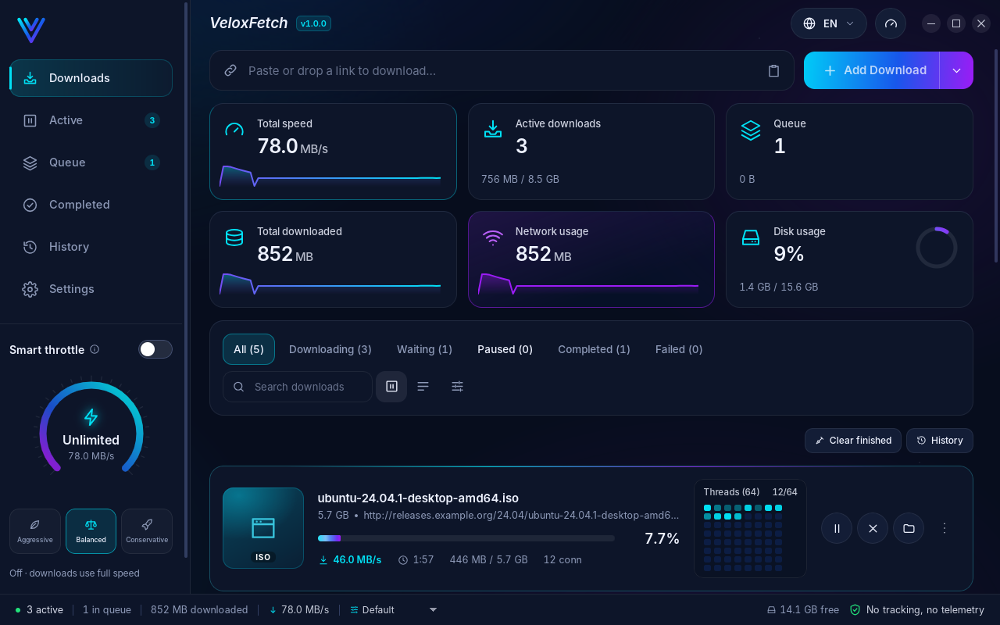
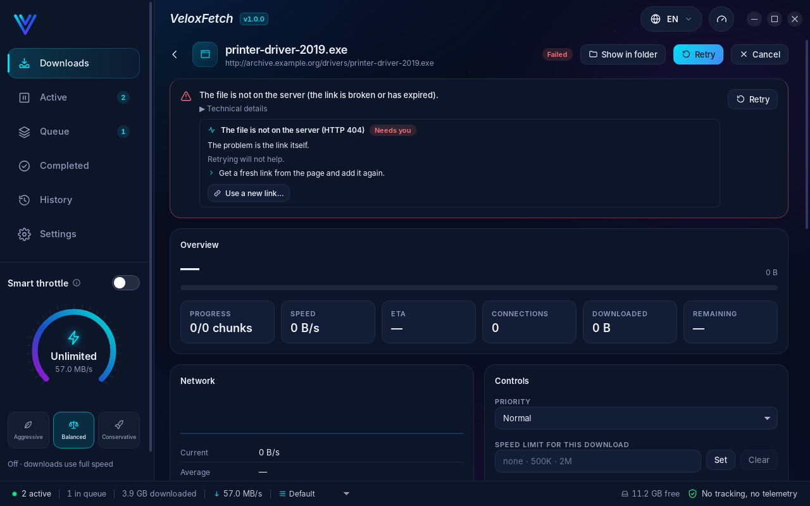
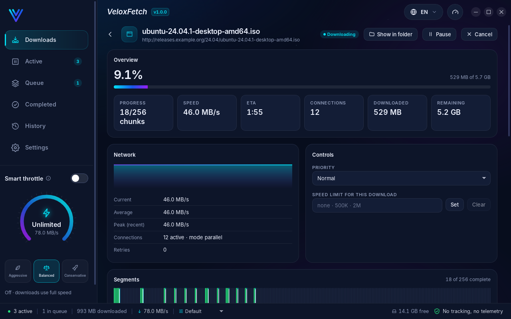
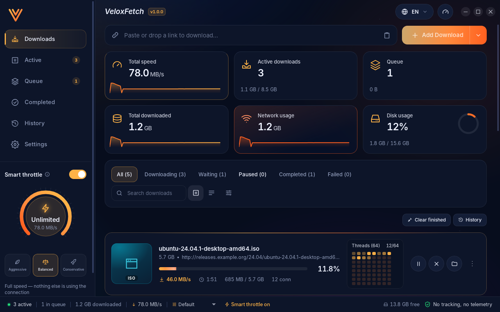
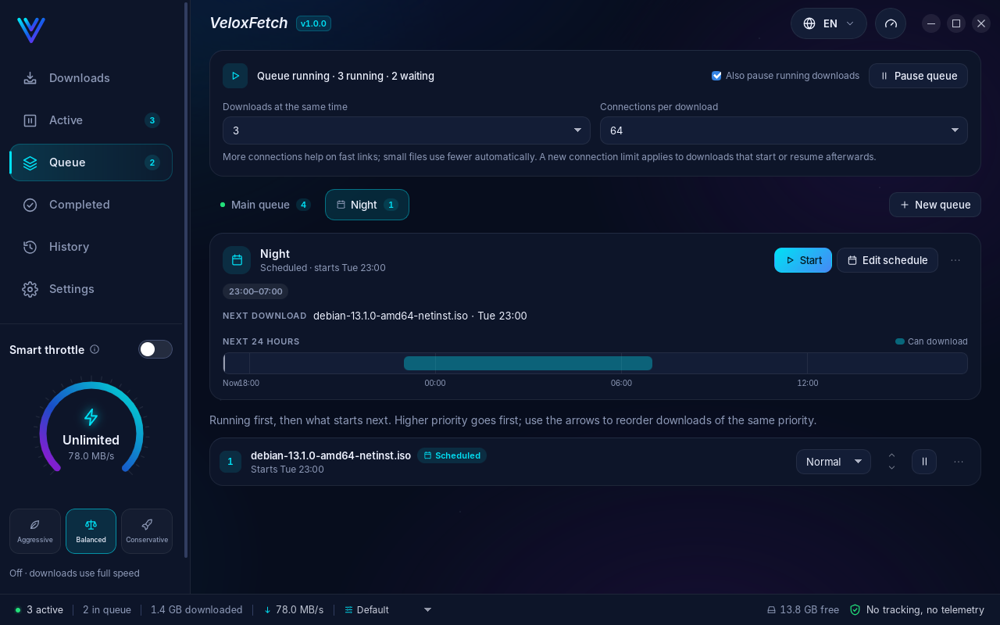
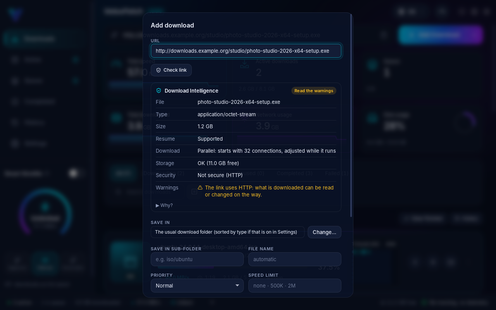
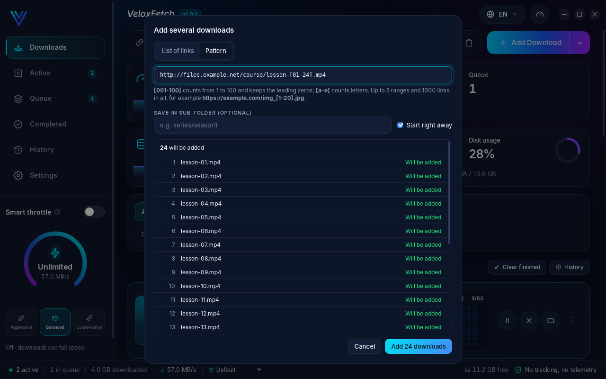
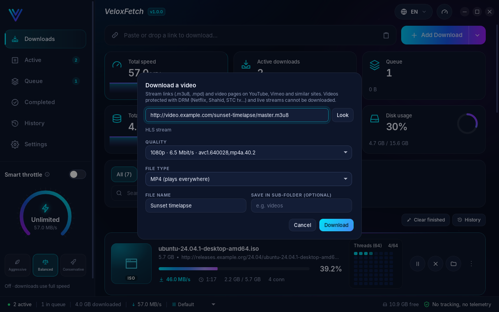
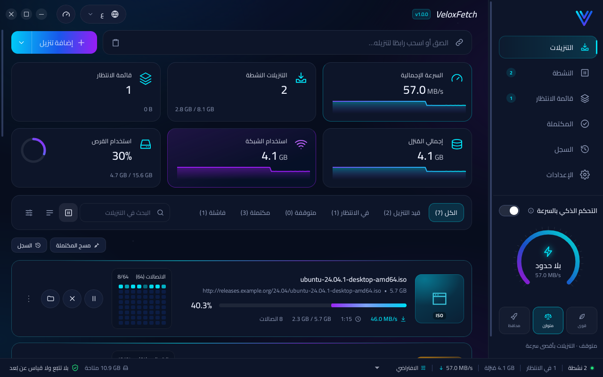
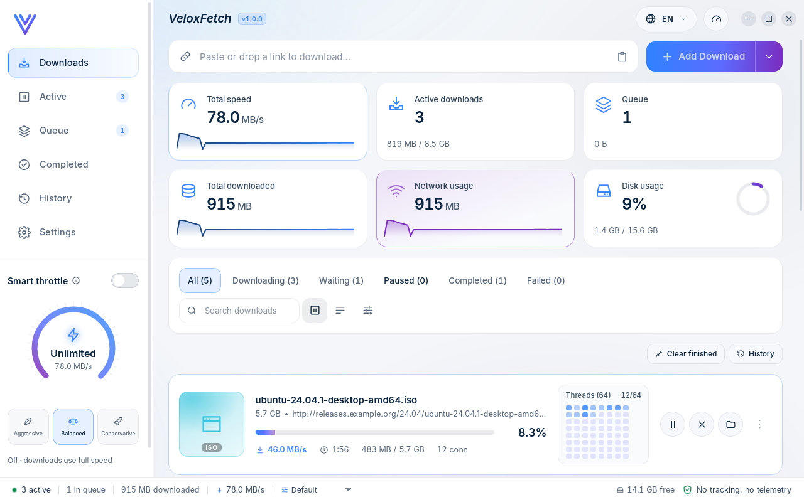

# VeloxFetch

### Faster downloads that never get lost.

Free download manager for **Windows and Linux** · English · Français · العربية

No ads · No account · No tracking

[**⬇ Download VeloxFetch 1.0.0**](https://github.com/IlyesBs/VeloxFetch-releases/releases/latest)

---

## Why you will like it

**⚡ Much faster downloads**
VeloxFetch splits each file into pieces and downloads them all at the same time, so you get the full speed of your
connection, even from slow servers.

**🛟 Never start over again**
Power cut, crash, computer restarted, connection lost? Your download continues exactly where it stopped. Even when a
download link expires, just paste a new one and it carries on.

**🩺 Knows why a download failed, and tells you how to fix it**
No more cryptic errors. VeloxFetch explains in plain words what went wrong and what to do: try again, sign in,
free some space, or get a fresh link.

**🎮 No more lag in your games and calls**
Turn on **Smart throttle** and VeloxFetch slows itself down while you play, watch or call, then goes back to full
speed when you are done. It recognises popular games and call apps on its own.

**🌙 Download while you sleep**
Put big downloads in a night queue, choose Wi-Fi only or avoid mobile data, and let the computer shut down or sleep
when everything is finished.

**🎬 Videos in the quality you want**
Save videos in the quality you choose, or keep only the sound as music. You can even watch a video while it downloads.

**🧠 Checks before it downloads**
Is there enough space? Do you already have this file? Can the download be resumed if it stops? VeloxFetch tells you
before you start, so there are no bad surprises.

**🌐 Works with your browser**
Install the extension for Chrome, Edge, Brave or Firefox, and your downloads go straight to VeloxFetch, even from
sites where you are signed in.

## Everything else you get

* Download many files at once: paste a list of links, or a numbered series like `lesson-01` to `lesson-24`
* Pause, resume, and set the order and priority of your downloads
* Speed limits whenever you need them, and ready-made profiles: Fast, Balanced, Low resource
* Files sorted into folders by type, and a file is never overwritten
* A history of everything you downloaded, to open it again or download it again
* Light and dark themes, fully translated into English, French and Arabic
* Updates itself safely, and only when you agree

| | |
|---|---|
|  |  |
|  |  |
|  |  |
|  |  |

## Download

Go to the [**latest release**](https://github.com/IlyesBs/VeloxFetch-releases/releases/latest) and pick the file for
your computer:

| Your computer | File to download |
|---|---|
| **Windows 10 / 11** | `VeloxFetch_..._x64-setup.exe` (or the portable `.zip`: no installation needed) |
| **Ubuntu, Debian, Mint** | `VeloxFetch_..._amd64.deb` |
| **Fedora, openSUSE** | `VeloxFetch-...x86_64.rpm` |
| **Any other Linux** | `VeloxFetch_..._amd64.AppImage` |

**On Windows**, a blue window may say *"Windows protected your PC"* the first time. This is normal for a new app:
click **More info**, then **Run anyway**.

**Download VeloxFetch only from this page.** Copies found elsewhere may have been changed.

## Your privacy

VeloxFetch has **no ads, no account and no tracking**. It does not collect or send anything about you. Your
passwords and sign-ins stay locked on your computer.

## Questions

**Is it really free?** Yes. No trial, no ads, nothing to unlock.

**Can it download from Netflix or other paid streaming services?** No. Protected videos cannot be downloaded, and
VeloxFetch tells you so right away.

**My download is slow, why?** Open the download: VeloxFetch shows what is limiting it (the website, your connection,
a speed limit you set, or your disk).

**Something does not work?** [Tell us here](https://github.com/IlyesBs/VeloxFetch-releases/issues). In the app,
**Settings > Diagnostics > Copy diagnostics report** gives a report without your passwords or sign-ins.

**You like VeloxFetch?** ⭐ Star this page and share it with your friends!

---

### بالعربية

**VeloxFetch** مدير تنزيلات مجاني لـويندوز ولينكس. تنزيلات أسرع بكثير، ولا تبدأ من الصفر أبدًا: بعد انقطاع الكهرباء
أو تعطل الجهاز أو انتهاء صلاحية الرابط، يكمل التنزيل من حيث توقف. يشرح لك بكلمات بسيطة سبب فشل أي تنزيل وكيف تصلحه،
ويخفّف السرعة تلقائيًا أثناء اللعب والمكالمات. تنزيلات ليلية، وفيديو بالجودة التي تختارها. بدون إعلانات، بدون حساب،
بدون تتبع.

### En français

**VeloxFetch** est un gestionnaire de téléchargements gratuit pour Windows et Linux. Des téléchargements bien plus
rapides, qui ne repartent jamais de zéro : après une coupure de courant, un plantage ou un lien expiré, il reprend là où
il s'était arrêté. Il explique simplement pourquoi un téléchargement a échoué et comment le réparer, et ralentit tout
seul pendant vos jeux et vos appels. Téléchargements de nuit, vidéos dans la qualité choisie. Sans publicité, sans
compte, sans pistage.
