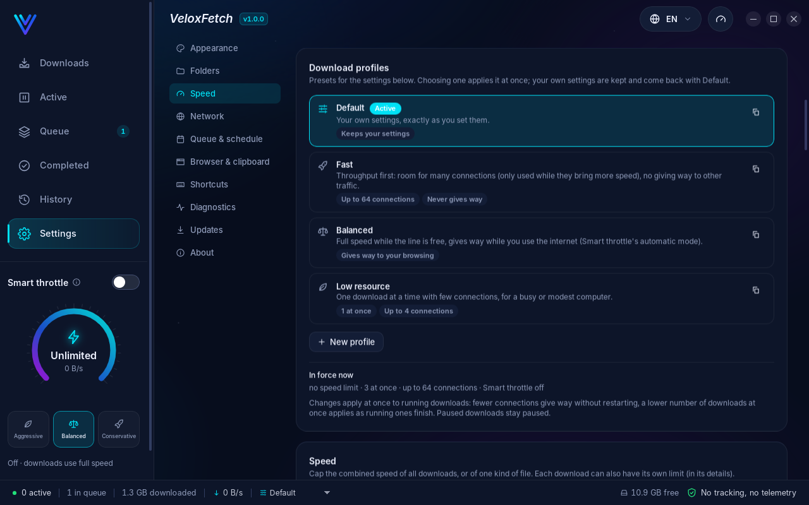

# VeloxFetch

**The download manager that finishes what it starts.**

Up to 64 connections per file · resumes after a crash, a power cut or an expired link · tells you in plain words
why a download failed · gives way to your games and calls · free, no account, no ads, no tracking.

**Windows · macOS · Linux** — English · Français · العربية

[**⬇ Download VeloxFetch 1.0.0**](https://github.com/IlyesBs/VeloxFetch-releases/releases/latest)

---

## Why VeloxFetch?

| Your problem | What VeloxFetch does |
|---|---|
| Downloads are slow, even on a fast line | Splits each file into pieces and fetches them over **up to 64 connections at once**. It starts gently and adds connections only while they make the download faster, so servers that dislike many connections are not hammered. |
| A big download stopped at 97 % and started again from zero | Progress is saved **every half second**, in an order that survives a crash or a power cut. VeloxFetch continues from the bytes really on your disk, and checks that the file on the server is still the same before it continues. |
| The link expired in the middle of the download | **Use a new link**: paste a fresh link to the same file and the download continues where it stopped. VeloxFetch first proves it is the same file, so two versions are never mixed. |
| "Download failed" and no idea why | **Download Doctor** says what happened, where the problem is (the server, your connection, your computer, the link), whether retrying will help, and what to do. |
| Your game lags or your video call freezes while something downloads | **Smart throttle** slows downloads while you browse, play or call, and gives them full speed back when the line is free. Games and call apps (League of Legends, Valorant, CS2, Zoom, Teams…) are recognised by name. |
| You want big downloads at night, not during the day | **Smart queues** with time windows ("23:00 – 07:00"), "only on Wi-Fi", "not on mobile data", "only when the computer is idle", and an optional shut down or sleep when everything is done. |
| The same file downloaded twice, or a 4 GB file on a disk that cannot hold it | **Before a download** VeloxFetch checks the size, the free space, the disk's limits, whether the server can resume, and whether you already have the file. |
| Videos | Video pages and streams (HLS, DASH) in the quality you choose: MP4, MKV, WebM, or the sound only (MP3, M4A, Opus). **Watch it while it downloads.** |

## Everything it does

### Speed
* Up to **64 connections per file**, adjusted live (4 → 16 → 64 while each step helps).
* Speed limits for everything, per kind of file and per download, changed while downloads run.
* **Download profiles**: Fast, Balanced, Low resource, or your own, applied in one click.
* Measured: the engine moves **1.1 – 1.8 GB/s** (in-memory test) and uses **1.4 – 3 % of one CPU core** at gigabit speed.

### Never lose a download
* Crash-safe progress, saved every 500 ms; resume after a restart, a crash or a power cut.
* Each finished piece is fingerprinted (SHA-256), so a damaged piece on disk is found and fetched again.
* Never mixes two versions of a file: the server's version is checked before every resume.
* **Use a new link** for expired, signed or session links.
* Automatic retries that respect what the server asks (`Retry-After`).
* Optional SHA-256 / SHA-512 checksum check at the end.

### Smart
* **Download Intelligence** before you start: size, type, resume support, free space, FAT32 4 GB limit, unencrypted
  links, temporary links, sign-in needed, already downloaded.
* **Smart duplicate detection**: a link you already have, in any state, with how sure the match is. Never replaces
  a file.
* **Download Doctor**: plain-language diagnosis of every failure, with the action that fixes it.
* **Smart throttle**: gives way to your browsing, games and calls (Aggressive / Balanced / Conservative).

### Organise
* Several **queues**, each with its own rules and schedule; priorities from Lowest to Highest; an express lane for
  urgent downloads.
* **Add many at once**: a list of links, a `.txt` file, or a pattern such as `lesson-[01-24].mp4`.
* Sorting into folders by type (Video, Music, Programs…), a folder per download, never overwriting a file.
* History you can search, **Download again**, open, show in folder, delete (always asks first).

### Browser
* Extension for **Chrome, Edge, Brave and Firefox** (and other Chromium browsers): right-click "Download with VeloxFetch", or let
  it take over browser downloads (it always asks before anything starts).
* Sign-in protected downloads work: the browser's cookies are passed on, kept sealed, and deleted when the download ends.
* Finds every downloadable link on a page, and adds a "Download video" bar over videos.
* Starts VeloxFetch when it is closed.

### On your desktop
* Tray icon, start with your computer (off by default), notifications, keyboard shortcuts.
* Keeps the computer awake while downloading; shut down, sleep or hibernate when everything is done (with a
  countdown you can cancel).
* Dark and light themes; **English, French and Arabic** (right to left).
* Updates itself: signed with the developer's offline key and checked before anything is installed. Nothing
  installs without your click.

| | |
|---|---|
|  |  |
|  |  |
|  |  |
|  |  |

## Download and install

Get the files from the [**latest release**](https://github.com/IlyesBs/VeloxFetch-releases/releases/latest).

| System | File | Notes |
|---|---|---|
| **Windows 10 / 11** (64-bit) | `VeloxFetch_x.y.z_x64-setup.exe` | Or `VeloxFetch-portable.zip`: no install, unzip and run. |
| **macOS** (Apple silicon / Intel) | `VeloxFetch_x.y.z_aarch64.dmg` / `_x64.dmg` | Drag VeloxFetch to Applications. |
| **Ubuntu, Debian, Mint, Pop!_OS** | `VeloxFetch_x.y.z_amd64.deb` | `sudo apt install ./VeloxFetch_*.deb` |
| **Fedora, openSUSE** | `VeloxFetch-x.y.z-1.x86_64.rpm` | `sudo dnf install ./VeloxFetch-*.rpm` |
| **Any Linux** | `VeloxFetch_x.y.z_amd64.AppImage` | `chmod +x VeloxFetch_*.AppImage` then run it. |
| **Browser extension** | `VeloxFetch-extension-*.zip` | Settings > Browser in the app connects it and shows you the steps. |

**First start on Windows.** VeloxFetch is not yet signed with a paid certificate, so Windows may show
*"Windows protected your PC"*. Click **More info**, then **Run anyway**. This happens with every new app that has no
certificate; it is not a sign of a problem. You can check that your file is genuine (below).

**First start on macOS.** If macOS says the app "cannot be opened" or "is damaged", open **System Settings > Privacy &
Security** and click **Open Anyway** next to VeloxFetch. If that button is not there, run once in Terminal:
`xattr -dr com.apple.quarantine /Applications/VeloxFetch.app`.

**Requirements.** Windows 10 or 11 (64-bit; WebView2, included in Windows 11 and installed by the setup if needed);
macOS 12 or later; Linux with WebKitGTK 4.1 (Ubuntu 22.04+, Debian 12+, Fedora 37+ and their families).

### Check that your download is genuine

Every release has a `SHA256SUMS.txt` with the fingerprint of each file.

* Windows (PowerShell): `Get-FileHash .\VeloxFetch_x.y.z_x64-setup.exe -Algorithm SHA256`
* macOS / Linux: `shasum -a 256 VeloxFetch_*` (or `sha256sum`)

The result must be exactly the line of `SHA256SUMS.txt` for that file. Only download VeloxFetch from this page:
copies offered elsewhere may be modified. Updates inside the app are always signed by the developer and checked
before they are installed, so a modified copy can never reach your computer through an update.

## Privacy

* **No account, no ads, no tracking, no telemetry.** VeloxFetch sends nothing about you anywhere.
* It connects only to the sites you download from, and, if you leave updates on, to this page to check for a new
  version.
* Passwords and cookies are sealed with your system's key store and removed when they are no longer needed. They are
  never written to logs or reports.
* Diagnostics stay on your computer; a report is only shared if you copy it yourself, and secrets are removed from it.

## Frequently asked questions

**Is VeloxFetch free?** Yes. No trial, no ads, no paid lock.

**Does it download from Netflix, Disney+ or other protected services?** No. Videos protected with DRM cannot be
downloaded, and VeloxFetch says so instead of failing halfway.

**Why is my download slower than expected?** Open the download's details: it shows the connections in use, the
speed of each, and what limits it (the server, a speed limit, Smart throttle, or your disk). Download Doctor explains
failures.

**Can I move my downloads from another download manager?** Add them all at once with **Add several** (paste the
links, or import a `.txt` list).

**Where are my files?** In your Downloads folder, sorted by type if you turn that on. Settings > Folders changes it.

## Support and feedback

* Found a problem or have an idea? [Open an issue](https://github.com/IlyesBs/VeloxFetch-releases/issues) and say
  your system, VeloxFetch's version (Settings > About), and what you did. Settings > Diagnostics > *Copy report*
  gives a report without secrets.
* Like it? ⭐ **Star this page** and tell your friends — it helps more than you think.

---

### بالعربية

**VeloxFetch** مدير تنزيلات مجاني لويندوز وماك ولينكس. يقسم كل ملف إلى أجزاء ويحمّلها عبر ما يصل إلى **64 اتصالًا** في
آن واحد، ويستأنف التنزيل بعد انقطاع الكهرباء أو تعطل الجهاز أو انتهاء صلاحية الرابط، ويشرح لك بكلمات بسيطة سبب فشل أي
تنزيل وكيف تصلحه. يخفّف السرعة تلقائيًا أثناء اللعب أو المكالمات، ويدعم قوائم انتظار ليلية، وتنزيل الفيديو بالجودة التي
تختارها. الواجهة متوفرة بالعربية (من اليمين إلى اليسار) والإنجليزية والفرنسية. بدون حساب، بدون إعلانات، بدون تتبع.

### En français

**VeloxFetch** est un gestionnaire de téléchargements gratuit pour Windows, macOS et Linux. Il découpe chaque fichier
et le télécharge par **jusqu'à 64 connexions** à la fois, reprend après une panne, une coupure de courant ou un lien
expiré, et explique en mots simples pourquoi un téléchargement a échoué et comment le réparer. Il ralentit tout seul
pendant vos jeux et vos appels, gère des files d'attente de nuit et télécharge les vidéos dans la qualité choisie.
Interface en français, en anglais et en arabe. Sans compte, sans publicité, sans pistage.
